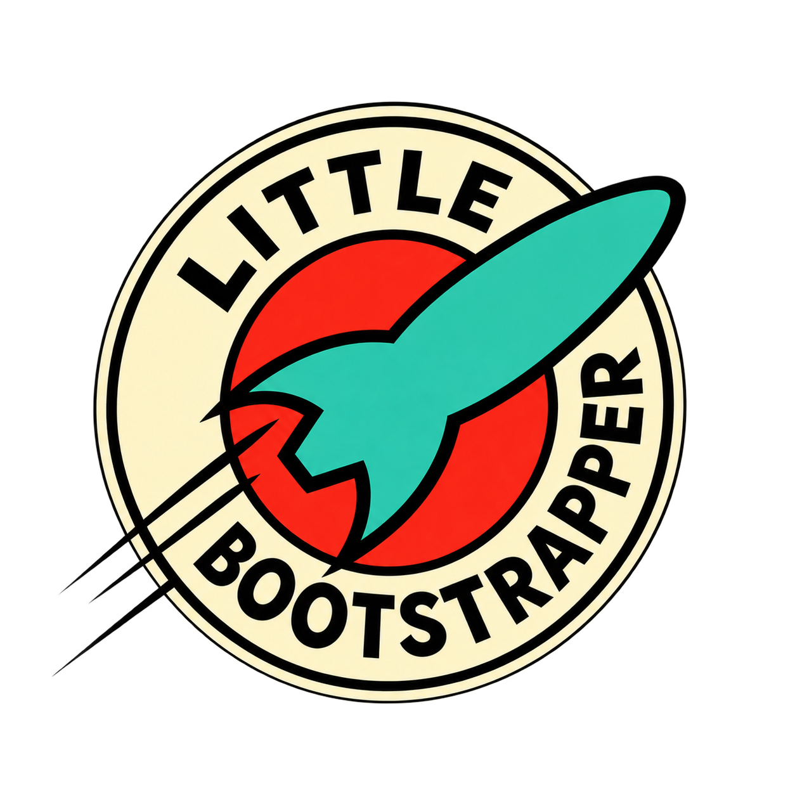

<p align="center">
  
</p>

# 🚀 little.bootstrapper — A library for better project starts

````````````text
                     `. ___
                    __,' __`.                _..----....____
        __...--.'``;.   ,.   ;``--..__     .'    ,-._    _.-'
  _..-''-------'   `'   `'   `'     O ``-''._   (,;') _,'
,'________________                          \`-._`-','
 `._              ```````````------...___   '-.._'-:
    ```--.._      ,.                     ````--...__\-.
            `.--. `-`                       ____    |  |`
              `. `.                       ,'`````.  ;  ;`
                `._`.        __________   `.      \'__/`
                   `-:._____/______/___/____`.     \  `
                               |       `._    `.    \
                               `._________`-.   `.   `.___
                                             SSt  `------'`
````````````

> **Good news, everyone!** `little.bootstrapper` is a polyglot NX monorepo & React Ink CLI that bootstraps projects with a **single universal AI agent ecosystem** (rules, skills, architecture boundaries, separated UI packages, and strictly pinned audited versions) across **Open Code, Antigravity, Claude, Codex, and Cursor**.

---

## ✨ Features

- **Universal AI Ecosystem (5 Agents, 1 Source of Truth)**: Generates 15 canonical rules & 7 skills in `.ai/` and bridges them identically to `AGENTS.md` (Open Code & Codex), `.agent/` (Antigravity), `CLAUDE.md` + `.claude/` (Claude), and `.cursor/rules/` (Cursor).
- **Mandatory UI Package Separation during Initialization**:
  - `packages/ui-cli` — Shared React Ink + `@inkjs/ui` animated CLI components (created when CLI frameworks are selected)
  - `packages/ui-web` — Shared Web UI components with ShadCN + Aceternity UI (created when Web frameworks are selected)
  - `packages/ui-mobile` — Shared Mobile UI components for React Native / Lynx (created when Mobile frameworks are selected)
- **All Core CLI Workflows**:
  - `init` — Interactive React Ink wizard (and `--yes` CI mode) with **searchable multi-select** for Frameworks, Project Domains (e.g. `financial`, `web3`), Verified Safe MCPs, Apps & Packages Editor, UI Package Separation, Architecture Selector, and Live Folder Preview.
  - `rules` — **Rules Marketplace** (`28` context-selective rules in `templates/rules/` + `12` skills in `templates/skills/`) covering frameworks (`nx-monorepo`, `ink`, `nextjs`, `shadcn-aceternity`, `playwright`, `mobile`, `rest-api`, `orm-database`, `nuxt-vue`, `tauri`, `smart-contracts`), languages (`typescript`, `go`, `rust`, `solidity`), and domains (`financial-rules`, `ai-docs-discipline`).
  - `mcps` — **Verified Safe MCP Marketplace** (`26` audited MCPs including `nx`, `nextjs-devtools`, `shadcn`, `playwright`, `tailwind`, `magic-ui`, `eslint`, `drizzle`, `mongodb`, `postgres`, `stripe`, `tauri`, `nuxt`, `context7`, `ai-memory`) with `--recommend` stack matching, `/` live search, and `mcp.json` + `.env.example` generation.
  - `normalize` — Detects existing tools/agents/rules/MCPs/UI packages in any repo, lets you pick the normalizing AI agent, and syncs missing tools, skills, MCPs & security configs (`.opengrep.yml`, `.gitleaks.toml`).
- **AI Anti-Doc-Sprawl Policy**: See [docs/AI-PATTERNS.md](./docs/AI-PATTERNS.md) for how we keep active AI context clean and prevent documentation bloat.
  - `update` — Audits all `package.json` files against the little.bootstrapper audited versions registry, flags CVEs & unpinned ranges (`^`/`~`), and pins/updates packages safely.
  - `validate` — **PR Pattern Validation Gate** (also wired into `.github/workflows/pr-validation.yml`) enforcing pinned deps, universal AI rules, MCP security, NX boundaries, test placement, anti-doc-sprawl, Ink/Next.js anti-patterns, and security configs.
  - `generate <name>` — Generates new modules adhering to your persisted `bootstrap.config.json` conventions.
- **Changelog & Automated Tag Releases**: Tracked in [CHANGELOG.md](./CHANGELOG.md) & [packages/initializer/CHANGELOG.md](./packages/initializer/CHANGELOG.md), automated via `yarn release <patch|minor|major>` ([scripts/release.sh](./scripts/release.sh)) and `.github/workflows/release.yml`.
- **Liquid Glassy Landing & Docs Page**: Built with Next.js (`15.5.29`), TypeScript, Tailwind CSS, **ShadCN** + **Aceternity UI** (Pro keys via `.env`) inside `packages/ui-web`, with Dark/Light mode and Futurama ASCII references. Typography matches nvim.setup: DM Sans body text, DM Serif Display italic accents, and IBM Plex Mono code; hero tracking is -0.06em, serif accents -0.05em, and section titles -0.04em. little.bootstrapper is the product; Fry and Bender references are playful asides, not endorsements. The hero background extends behind the floating navbar. Docs provide spaced reference cards and a sticky section navigator (a horizontal strip on mobile); the shared footer links to documentation and landing sections.
- **Full Test Pyramid**:
  - **Unitary Tests**: Inside `src/**/__tests__/*.unit.test.ts` (close to implementation)
  - **Integration Tests**: Inside `src/**/__tests__/*.integration.test.ts` (close to implementation)
  - **E2E Tests (Root `tests/e2e/` only)**: `packages/initializer/tests/e2e/` (real spawned CLI binary) + `apps/web/tests/e2e/` (Playwright Chromium browser suite)

---

## Native workspace commands

Every generated Go, Rust, or Solidity app/package has a local `Makefile`, regardless of the legacy `useMakefiles` setting. The standard targets are `build`, `start`, `dev`, and `test`; running bare `make` defaults to `test` both locally and at the root. Root Make targets cover native workspaces; JavaScript workspaces keep their package-manager commands.

```sh
make                       # Test all native workspaces
make build                 # Build all native workspaces
make start                 # Start native executables and local contract nodes in parallel
make dev                   # Run local native development commands in parallel
make test-packages-core    # Test packages/core only
make build-apps-api        # Build apps/api only
make -C packages/core test # Run the same command directly in a workspace
```

Individual root targets follow `<command>-apps-<name>` or `<command>-packages-<name>`. Go apps use `go run .` for development; Rust executables use `cargo run`. Library `dev` targets run native tests, while their `start` targets fail with an explanation that they have no executable. Root `start` skips libraries. Foundry uses `forge build`, `forge test`, `forge test --watch` for development, and `anvil` for a local node. Hardhat uses `compile`, `test`, and `node` through its pinned local dependency. Install the relevant native toolchains before running these targets. Nx delegates native targets to each workspace's Makefile.

## 🏁 Quick Start

```bash
# Install dependencies (Yarn v4 / 4.19.0 workspaces)
yarn install

# Build all packages & apps
yarn build

# Run Unitary, Integration & E2E Tests
yarn test:unit
yarn test:integration
yarn test:e2e

# Launch the little.bootstrapper React Ink CLI
yarn cli

# Install locally into ~/.local/bin (installs `little-bootstrapper` & `planet-express`)
yarn install:local
# Uninstall from ~/.local/bin
yarn uninstall:local

# Launch the Liquid Glassy Landing & Docs Page
yarn dev:web
```

---

## Netlify deployment

The root `netlify.toml` builds the web workspace with `yarn workspace @little-bootstrapper/web build` and publishes `apps/web/.next`. Dependencies are installed from the repository root using the pinned Yarn version. Netlify's Next.js adapter handles the build output; `dist/apps/web` is not generated by this app.

## 🏗️ Monorepo & Atomic CLI Architecture

```text
little.bootstrapper/
├── apps/
│   └── web/                        # Next.js Liquid Glassy Landing & Docs Page + Playwright E2E
├── packages/
│   ├── initializer/                # React Ink + TypeScript + Vitest CLI
│   │   ├── src/
│   │   │   ├── cli.tsx             # Thin CLI entrypoint
│   │   │   ├── commands/           # Completely isolated CLI command handlers + router
│   │   │   ├── modules/            # Swappable domain units (each with barrel + __tests__/)
│   │   │   │   ├── architecture/   # Compatibility matrix, naming & folder preview
│   │   │   │   ├── catalog/        # Stack catalog, audited versions & verified safe MCPs
│   │   │   │   ├── validation/     # Zod schemas for CLI args, TUI inputs & bootstrap.config.json
│   │   │   │   ├── generators/     # Project, module, AI ecosystem & mcp.json generators
│   │   │   │   └── workflows/      # Normalize & Update Helper workflows
│   │   │   ├── ui/screens/         # Isolated React Ink TUI screens (1 screen per workflow)
│   │   │   ├── types/              # Pure domain contracts split by bounded context
│   │   │   └── assets/ascii/       # Decoupled Futurama ASCII visual assets
│   │   └── tests/e2e/              # Root E2E suite only (real compiled CLI binary)
│   ├── ui-cli/                     # Shared React Ink CLI UI components (@little-bootstrapper/ui-cli)
│   └── ui-web/                     # Shared ShadCN + Aceternity UI Web components (@little-bootstrapper/ui-web)
├── .ai/                            # Canonical universal AI rules (15) & skills (7)
├── mcp.json                        # Verified safe MCP servers config
├── .opengrep.yml & .gitleaks.toml  # Security scanners config
├── bootstrap.config.json           # Persisted project architecture & stack config
└── nx.json                         # NX monorepo configuration
```

_(Note: `packages/ui-mobile` is scaffolded automatically by the initializer whenever a project selects mobile frameworks such as React Native or Lynx.)_

---

## 🤖 Mascot

```text
      _
     ( )
      H
      H
     _H_
  .-'-.-'-.
 /         \
|           |
|   .-------'._
|  / /  '.' '. \
|  \ \ @   @ / /
|   '---------'
|    _______|
|  .'-+-+-+|
|  '.-+-+-+|         Silver Saks
|    """""" |
'-.__   __.-'
     """
```

> _"Bite my shiny metal scaffold!"_

---

## 🤝 Contributing

See [CONTRIBUTING.md](./CONTRIBUTING.md) for guidelines on commits, quality gating, and docs sync.
